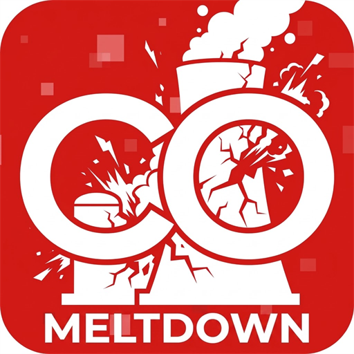

<div align="center">
  
  <h1>CoreProtect Meltdown</h1>
  <p><strong>Factory-Event Admission Control, SQLite Query Acceleration & Hotspot Diagnostics Addon for CoreProtect (Minecraft 26.2 ~ 26.3 Fabric)</strong></p>
  <p><strong>Minecraft 26.2 ~ 26.3 (Fabric) 용 CoreProtect 대용량 공장 폭주 방어 · 쿼리 가속 · 핫스팟 진단 애드온</strong></p>
</div>

> [!NOTE]
> **AI Utilization Disclosure (AI 사용 명시)**  
> 본 프로젝트의 코드 설계, SQLite 쿼리/인덱스 최적화, 폭주 제어 알고리즘 구현, 테스트 및 문서화 과정에는 AI 코딩 어시스턴트(**Google Antigravity**)가 활용되었습니다.  
> *This project was developed, optimized, and documented with the assistance of AI (**Google Antigravity**).*

> [!IMPORTANT]
> **CoreProtect Dependency & Copyright Notice (필수 의존성 및 저작권 안내)**  
> * **CoreProtect Meltdown** is an independent **server-side Mixin companion mod (addon)** that attaches to `CoreProtect (Fabric Edition)` at runtime.  
> * **No CoreProtect code, decompiled sources, classes, or binaries are bundled** in this repository or its release JARs (`No CoreProtect code bundled`).  
> * To use this mod, you must obtain **`CoreProtect (Fabric Edition)`** (`coreprotect-fabric-1.3.jar`) separately via the official **[CoreProtect Patreon](https://www.patreon.com/coreprotect)** and place it in your server's `mods/` directory alongside this addon.  
> * 본 저장소 및 배포되는 JAR 파일에는 **CoreProtect 원본 소스 코드, 디컴파일 코드, 클래스 또는 바이너리가 일절 포함되어 있지 않습니다.** 반드시 공식 Patreon을 통해 입수한 `coreprotect-fabric-1.3.jar`와 함께 사용해야 합니다.

---

## English Overview

**CoreProtect Meltdown** prevents high-throughput redstone/piston/hopper contraptions and mob farms from flooding the CoreProtect consumer queue or stalling SQLite writes, while accelerating `/co near` and `/co lookup` queries on multi-million-row databases.

### Key Features

* **Factory-Event Admission & Rate Limiter**:
  * Tracks event rates per 3D cell, actor, and category in real time, throttling automated redstone/hopper/farm spikes while **preserving 100% of genuine player actions and audit logs**.
* **SQLite Composite Indexes & Query Optimizer (`~25ms` Lookups)**:
  * Automatically ensures `(wid, x, z, time)` composite indexes as well as `entity_spawn`, `username_log`, and `LOWER(user)` indexes.
  * Rewrites small-radius bounding boxes into `x IN (...)`, converts cross-table `OR` filters into index-friendly subqueries, and applies per-branch Top-N limits on `UNION ALL` queries.
* **Enhanced `/co near` & `/co lookup` Ergonomics**:
  * `/co near` queries older history cleanly and accepts bare numbers (e.g., `/co near 15` -> `r:15`).
  * `/co lookup <player>` searches across all dimensions and all time without requiring `t:`, including historical username lookups via `username_log`.
* **In-Game Hotspot Heatmap & One-Click Teleport (`/co debug`)**:
  * Displays top event-drop hotspots in chat with clickable **`[Teleport]`** (`[텔레포트]`) buttons.
* **Built-In Localization (`en_us.json` & `ko_kr.json`)**:
  * Automatically detects each player's client language (`ko_*` -> Korean, otherwise English) or allows manual override via `/co debug lang [auto|en_us|ko_kr]`.

### Commands (`/co debug`)

| Command | Description |
| :--- | :--- |
| `/co debug status` | View protection status, queue depth, heap usage, and admission/drop statistics |
| `/co debug heatmap [1..50\|test]` | Show top overload hotspots with clickable **`[Teleport]`** buttons |
| `/co debug config [key]` | Inspect active `coreprotect-meltdown.properties` values |
| `/co debug lang [auto\|en_us\|ko_kr]` | Check or switch display language (`auto`, `en_us`, `ko_kr`) |
| `/co debug reload` | Reload configuration atomically without restarting the server |

---

## 한국어 개요 (Korean Overview)

**CoreProtect Meltdown**은 대규모 자동화 공장·회로에서 발생하는 초당 수천 건의 블록/컨테이너/엔티티 이벤트로 인해 CoreProtect 소비자 큐가 밀리거나 SQLite DB가 폭주하는 현상을 방지하고, 수백만 행 규모의 데이터베이스에서도 `/co near` 및 `/co lookup` 조회가 즉시 응답하도록 개선하는 서버 사이드 확장 모드입니다.

### 주요 기능

* **공장 이벤트 폭주 제어 (Factory-Event Admission & Limiter)**:
  * 청크·좌표·카테고리별 이벤트 발생률을 실시간 추적하여 대량 공장 트래픽만 선택적으로 감쇠하고, **실제 플레이어의 직접적인 행동 및 감사 로그(Audit Trail)는 100% 보존**합니다.
* **SQLite 복합 인덱스 보강 및 조회 쿼리 최적화 (`~25ms` 응답)**:
  * `(wid, x, z, time)` 복합 인덱스 및 `entity_spawn`, `username_log`, `LOWER(user)` 인덱스를 자동 보장합니다.
  * 소규모 반경 조회 시 `x IN (...)` 변환, 교차 테이블 `OR` 서브쿼리 재작성, `UNION ALL` 브랜치별 Top-N 제한을 통해 대용량 DB 풀스캔과 서버 타임아웃을 방지합니다.
* **`/co near` 및 `/co lookup` 편의성 개선**:
  * `/co near` 실행 시 24시간 이전의 오래된 기록까지 정상 조회되며, `/co near 15`처럼 숫자만 입력해도 반경(`r:15`)으로 자동 인식합니다.
  * `/co lookup <플레이어>` 실행 시 시간(`t:`) 인자를 생략해도 전체 기간 및 전 차원을 조회할 수 있으며, 과거 닉네임(`username_log`) 역추적을 지원합니다.
* **인게임 핫스팟 히트맵 및 원클릭 텔레포트 (`/co debug`)**:
  * 현재 DB 부하를 유발하는 상위 핫스팟 좌표를 컬러 UI로 확인하고, 채팅창의 **`[텔레포트]`** (`[Teleport]`) 버튼을 클릭해 해당 위치로 즉시 이동할 수 있습니다.
* **다국어 지원 (`en_us.json` & `ko_kr.json`)**:
  * 접속한 플레이어의 클라이언트 언어 설정(`en_us` / `ko_kr`)을 자동으로 감지하여 영어 또는 한국어로 출력하며, `/co debug lang [auto|en_us|ko_kr]` 명령어로 언어를 직접 지정할 수도 있습니다.

---

## 요구 사항 (Requirements)

* **Minecraft**: `26.2` ~ `26.3`
* **Fabric Loader**: `>=0.19.3`
* **Java**: `>=25`
* **Required Mod (필수 모드)**:
  * **CoreProtect (Fabric Edition)** `1.3` — [Official Patreon](https://www.patreon.com/coreprotect)에서 후원 후 별도 입수 필요

---

## 명령어 및 권한 (`/co debug`)

| 명령어 | 설명 |
| :--- | :--- |
| `/co debug status` | 현재 폭주 제어 상태, 큐 적체량, 허용/차단 통계 요약 확인 |
| `/co debug heatmap` | 이벤트 폭주 상위 핫스팟 목록 및 클릭형 **`[텔레포트]`** 버튼 출력 |
| `/co debug config` | 현재 적용된 `coreprotect-meltdown.properties` 설정값 확인 |
| `/co debug lang [auto\|en_us\|ko_kr]` | 표시 언어 확인 및 전환 (`auto`, `en_us`, `ko_kr`) |
| `/co debug reload` | 서버 재시작 없이 설정 파일 다시 불러오기 |

### LuckPerms 권한 노드 (Permissions)
* `coreprotect.debug` — `/co debug` 기본 상태 및 히트맵 조회 권한
* `coreprotect.meltdown.admin` — 히트맵 원클릭 텔레포트(`/co debug tp`) 및 관리자 퀵 버튼 사용 권한

---

## 빌드 방법 (Building from Source)

자체 빌드를 수행하려면 서버 라이브러리 경로와 정식으로 입수한 `coreprotect-fabric-1.3.jar` 경로를 지정하여 `build.py`를 실행합니다 (컴파일 참조용으로만 사용되며 결과물 JAR에는 포함되지 않습니다).

```bash
python3 build.py --server /path/to/server --coreprotect /path/to/coreprotect-fabric-1.3.jar
```

---

## 라이선스 (License)

* [MIT License](./LICENSE) (Applies to CoreProtect Meltdown's own code only; all rights to CoreProtect belong to its original authors.)
